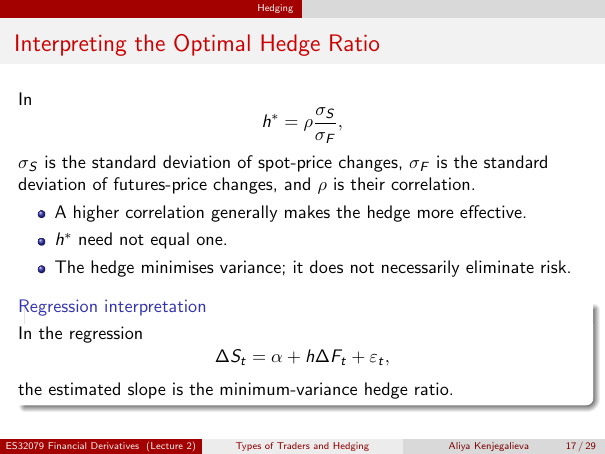

# Physical page 17 — raw extraction, needs review

<a id="page-17"></a>



Raw layout text below may flatten formulas, tables and glyphs. The image is source evidence; no semantic verification is claimed.

```text
                                                  Hedging


 Interpreting the Optimal Hedge Ratio

  In
                                                              σS
                                                   h∗ = ρ        ,
                                                              σF
  σS is the standard deviation of spot-price changes, σF is the standard
  deviation of futures-price changes, and ρ is their correlation.
          A higher correlation generally makes the hedge more effective.
          h∗ need not equal one.
          The hedge minimises variance; it does not necessarily eliminate risk.

  Regression interpretation
  In the regression
                                            ∆St = α + h∆Ft + εt ,
  the estimated slope is the minimum-variance hedge ratio.

ES32079 Financial Derivatives (Lecture 2)     Types of Traders and Hedging   Aliya Kenjegalieva   17 / 29

```
