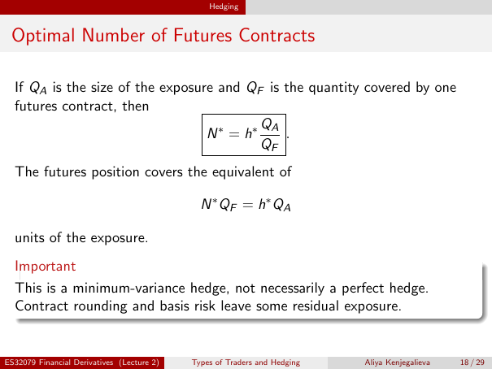

# Physical page 18 — raw extraction, needs review

<a id="page-18"></a>



Raw layout text below may flatten formulas, tables and glyphs. The image is source evidence; no semantic verification is claimed.

```text
                                                Hedging


 Optimal Number of Futures Contracts

  If QA is the size of the exposure and QF is the quantity covered by one
  futures contract, then
                                           QA
                                  N ∗ = h∗    .
                                           QF
  The futures position covers the equivalent of

                                              N ∗ QF = h∗ QA

  units of the exposure.
  Important
  This is a minimum-variance hedge, not necessarily a perfect hedge.
  Contract rounding and basis risk leave some residual exposure.


ES32079 Financial Derivatives (Lecture 2)   Types of Traders and Hedging   Aliya Kenjegalieva   18 / 29

```
