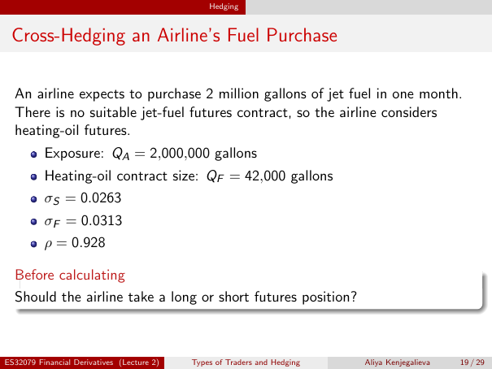

# Physical page 19 — raw extraction, needs review

<a id="page-19"></a>



Raw layout text below may flatten formulas, tables and glyphs. The image is source evidence; no semantic verification is claimed.

```text
                                                Hedging


 Cross-Hedging an Airline’s Fuel Purchase

  An airline expects to purchase 2 million gallons of jet fuel in one month.
  There is no suitable jet-fuel futures contract, so the airline considers
  heating-oil futures.
          Exposure: QA = 2,000,000 gallons
          Heating-oil contract size: QF = 42,000 gallons
          σS = 0.0263
          σF = 0.0313
          ρ = 0.928

  Before calculating
  Should the airline take a long or short futures position?


ES32079 Financial Derivatives (Lecture 2)   Types of Traders and Hedging   Aliya Kenjegalieva   19 / 29

```
