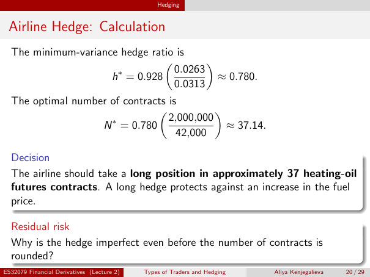

# Physical page 20 — raw extraction, needs review

<a id="page-20"></a>



Raw layout text below may flatten formulas, tables and glyphs. The image is source evidence; no semantic verification is claimed.

```text
                                                Hedging


 Airline Hedge: Calculation
  The minimum-variance hedge ratio is
                                        
                      ∗           0.0263
                     h = 0.928             ≈ 0.780.
                                  0.0313
  The optimal number of contracts is
                                           
                     ∗            2,000,000
                   N = 0.780                  ≈ 37.14.
                                    42,000

  Decision
  The airline should take a long position in approximately 37 heating-oil
  futures contracts. A long hedge protects against an increase in the fuel
  price.

  Residual risk
  Why is the hedge imperfect even before the number of contracts is
  rounded?
ES32079 Financial Derivatives (Lecture 2)   Types of Traders and Hedging   Aliya Kenjegalieva   20 / 29

```
