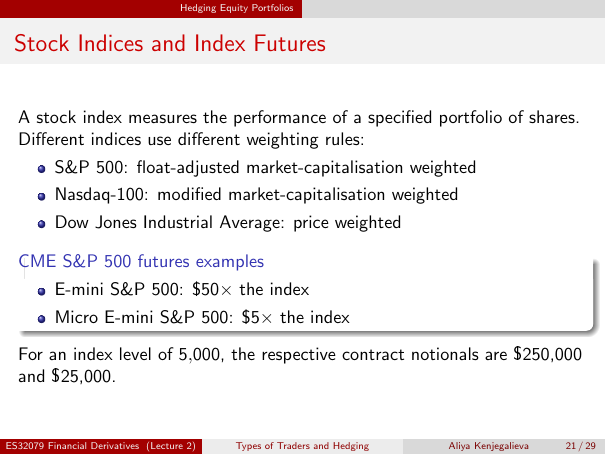

# Physical page 21 — raw extraction, needs review

<a id="page-21"></a>



Raw layout text below may flatten formulas, tables and glyphs. The image is source evidence; no semantic verification is claimed.

```text
                                     Hedging Equity Portfolios


 Stock Indices and Index Futures

  A stock index measures the performance of a specified portfolio of shares.
  Different indices use different weighting rules:
          S&P 500: float-adjusted market-capitalisation weighted
          Nasdaq-100: modified market-capitalisation weighted
          Dow Jones Industrial Average: price weighted

  CME S&P 500 futures examples
          E-mini S&P 500: $50× the index
          Micro E-mini S&P 500: $5× the index

  For an index level of 5,000, the respective contract notionals are $250,000
  and $25,000.


ES32079 Financial Derivatives (Lecture 2)        Types of Traders and Hedging   Aliya Kenjegalieva   21 / 29

```
