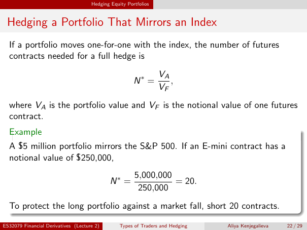

# Physical page 22 — raw extraction, needs review

<a id="page-22"></a>



Raw layout text below may flatten formulas, tables and glyphs. The image is source evidence; no semantic verification is claimed.

```text
                                     Hedging Equity Portfolios


 Hedging a Portfolio That Mirrors an Index
  If a portfolio moves one-for-one with the index, the number of futures
  contracts needed for a full hedge is
                                                                 VA
                                                       N∗ =         ,
                                                                 VF
  where VA is the portfolio value and VF is the notional value of one futures
  contract.
  Example
  A $5 million portfolio mirrors the S&P 500. If an E-mini contract has a
  notional value of $250,000,
                                                       5,000,000
                                             N∗ =                = 20.
                                                        250,000
  To protect the long portfolio against a market fall, short 20 contracts.

ES32079 Financial Derivatives (Lecture 2)        Types of Traders and Hedging   Aliya Kenjegalieva   22 / 29

```
