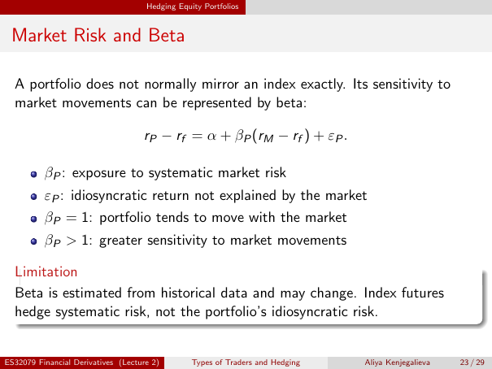

# Physical page 23 — raw extraction, needs review

<a id="page-23"></a>



Raw layout text below may flatten formulas, tables and glyphs. The image is source evidence; no semantic verification is claimed.

```text
                                     Hedging Equity Portfolios


 Market Risk and Beta

  A portfolio does not normally mirror an index exactly. Its sensitivity to
  market movements can be represented by beta:

                                    rP − rf = α + βP (rM − rf ) + εP .

          βP : exposure to systematic market risk
          εP : idiosyncratic return not explained by the market
          βP = 1: portfolio tends to move with the market
          βP > 1: greater sensitivity to market movements

  Limitation
  Beta is estimated from historical data and may change. Index futures
  hedge systematic risk, not the portfolio’s idiosyncratic risk.


ES32079 Financial Derivatives (Lecture 2)        Types of Traders and Hedging   Aliya Kenjegalieva   23 / 29

```
