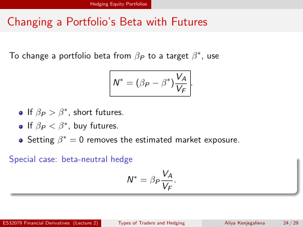

# Physical page 24 — raw extraction, needs review

<a id="page-24"></a>



Raw layout text below may flatten formulas, tables and glyphs. The image is source evidence; no semantic verification is claimed.

```text
                                     Hedging Equity Portfolios


 Changing a Portfolio’s Beta with Futures

  To change a portfolio beta from βP to a target β ∗ , use

                                                                        VA
                                              N ∗ = (βP − β ∗ )            .
                                                                        VF

          If βP > β ∗ , short futures.
          If βP < β ∗ , buy futures.
          Setting β ∗ = 0 removes the estimated market exposure.

  Special case: beta-neutral hedge
                                                                   VA
                                                    N ∗ = βP          .
                                                                   VF


ES32079 Financial Derivatives (Lecture 2)        Types of Traders and Hedging   Aliya Kenjegalieva   24 / 29

```
