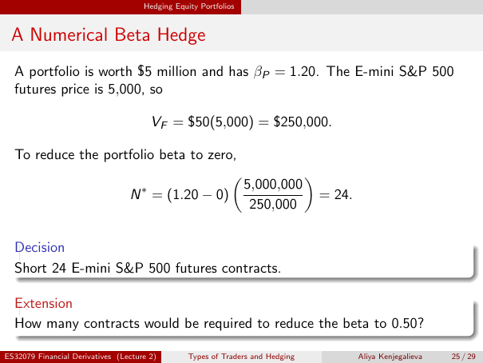

# Physical page 25 — raw extraction, needs review

<a id="page-25"></a>



Raw layout text below may flatten formulas, tables and glyphs. The image is source evidence; no semantic verification is claimed.

```text
                                     Hedging Equity Portfolios


 A Numerical Beta Hedge
  A portfolio is worth $5 million and has βP = 1.20. The E-mini S&P 500
  futures price is 5,000, so

                                       VF = $50(5,000) = $250,000.

  To reduce the portfolio beta to zero,
                                                 
                      ∗                 5,000,000
                    N = (1.20 − 0)                  = 24.
                                         250,000

  Decision
  Short 24 E-mini S&P 500 futures contracts.

  Extension
  How many contracts would be required to reduce the beta to 0.50?

ES32079 Financial Derivatives (Lecture 2)        Types of Traders and Hedging   Aliya Kenjegalieva   25 / 29

```
