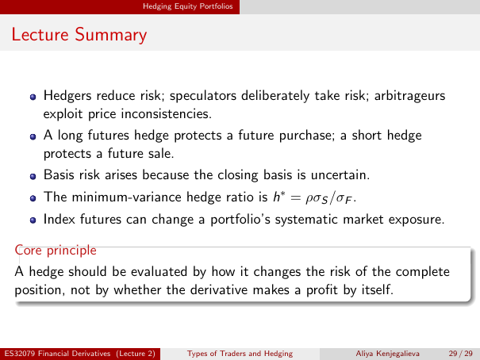

# Physical page 29 — raw extraction, needs review

<a id="page-29"></a>



Raw layout text below may flatten formulas, tables and glyphs. The image is source evidence; no semantic verification is claimed.

```text
                                     Hedging Equity Portfolios


 Lecture Summary


          Hedgers reduce risk; speculators deliberately take risk; arbitrageurs
          exploit price inconsistencies.
          A long futures hedge protects a future purchase; a short hedge
          protects a future sale.
          Basis risk arises because the closing basis is uncertain.
          The minimum-variance hedge ratio is h∗ = ρσS /σF .
          Index futures can change a portfolio’s systematic market exposure.

  Core principle
  A hedge should be evaluated by how it changes the risk of the complete
  position, not by whether the derivative makes a profit by itself.


ES32079 Financial Derivatives (Lecture 2)        Types of Traders and Hedging   Aliya Kenjegalieva   29 / 29

```
