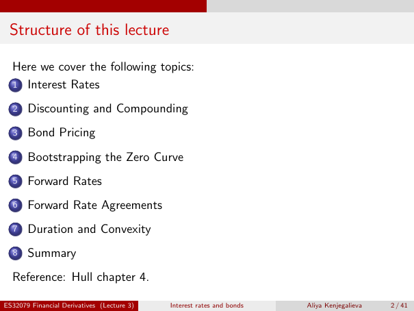

# Physical page 2 — raw extraction, needs review

<a id="page-2"></a>



Raw layout text below may flatten formulas, tables and glyphs. The image is source evidence; no semantic verification is claimed.

```text
 Structure of this lecture

  Here we cover the following topics:
  1 Interest Rates

  2    Discounting and Compounding
  3    Bond Pricing
  4    Bootstrapping the Zero Curve
  5    Forward Rates
  6    Forward Rate Agreements
  7    Duration and Convexity
  8    Summary
  Reference: Hull chapter 4.

ES32079 Financial Derivatives (Lecture 3)   Interest rates and bonds   Aliya Kenjegalieva   2 / 41

```
