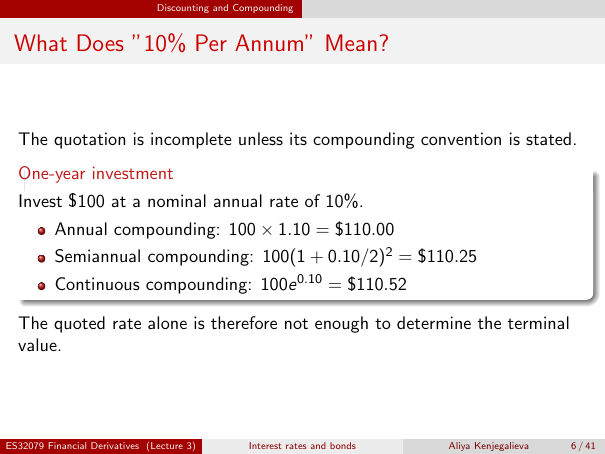

# Physical page 6 — raw extraction, needs review

<a id="page-6"></a>



Raw layout text below may flatten formulas, tables and glyphs. The image is source evidence; no semantic verification is claimed.

```text
                                Discounting and Compounding


 What Does ”10% Per Annum” Mean?


  The quotation is incomplete unless its compounding convention is stated.
  One-year investment
  Invest $100 at a nominal annual rate of 10%.
          Annual compounding: 100 × 1.10 = $110.00
          Semiannual compounding: 100(1 + 0.10/2)2 = $110.25
          Continuous compounding: 100e 0.10 = $110.52

  The quoted rate alone is therefore not enough to determine the terminal
  value.


ES32079 Financial Derivatives (Lecture 3)         Interest rates and bonds   Aliya Kenjegalieva   6 / 41

```
