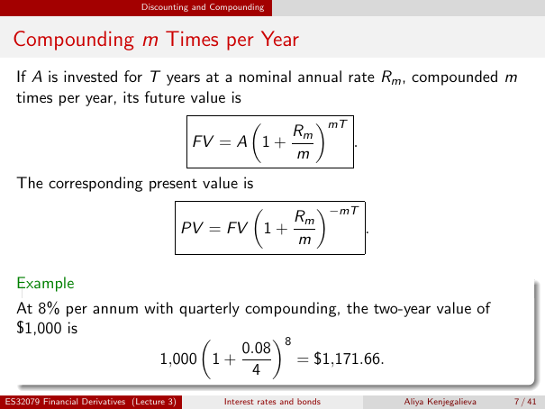

# Physical page 7 — raw extraction, needs review

<a id="page-7"></a>



Raw layout text below may flatten formulas, tables and glyphs. The image is source evidence; no semantic verification is claimed.

```text
                                Discounting and Compounding


 Compounding m Times per Year
  If A is invested for T years at a nominal annual rate Rm , compounded m
  times per year, its future value is

                                           Rm mT
                                             
                             FV = A 1 +             .
                                            m
  The corresponding present value is

                                      Rm −mT
                                       
                         PV = FV 1 +         .
                                      m

  Example
  At 8% per annum with quarterly compounding, the two-year value of
  $1,000 is
                                0.08 8
                                   
                    1,000 1 +          = $1,171.66.
                                  4
ES32079 Financial Derivatives (Lecture 3)         Interest rates and bonds   Aliya Kenjegalieva   7 / 41

```
