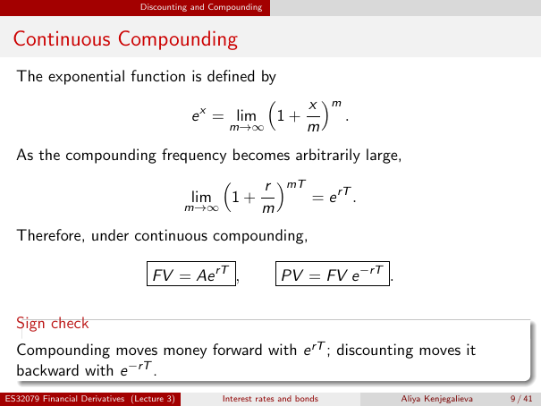

# Physical page 9 — raw extraction, needs review

<a id="page-9"></a>



Raw layout text below may flatten formulas, tables and glyphs. The image is source evidence; no semantic verification is claimed.

```text
                                Discounting and Compounding


 Continuous Compounding
  The exponential function is defined by
                                        x m
                           e x = lim 1 +      .
                                 m→∞     m
  As the compounding frequency becomes arbitrarily large,
                                  r mT
                         lim 1 +         = e rT .
                        m→∞        m
  Therefore, under continuous compounding,

                                   FV = Ae rT ,                 PV = FV e −rT .

  Sign check
  Compounding moves money forward with e rT ; discounting moves it
  backward with e −rT .
ES32079 Financial Derivatives (Lecture 3)         Interest rates and bonds        Aliya Kenjegalieva   9 / 41

```
