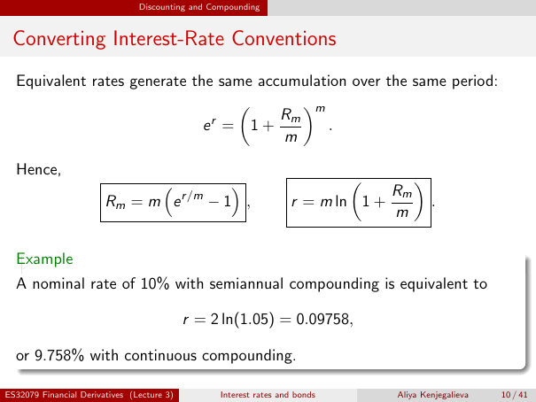

# Physical page 10 — raw extraction, needs review

<a id="page-10"></a>



Raw layout text below may flatten formulas, tables and glyphs. The image is source evidence; no semantic verification is claimed.

```text
                                Discounting and Compounding


 Converting Interest-Rate Conventions
  Equivalent rates generate the same accumulation over the same period:

                                        Rm m
                                          
                               r
                              e = 1+          .
                                         m

  Hence,
                                                                                      
                                      
                                            r /m
                                                                                 Rm
                        Rm = m e                   −1 ,              r = m ln 1 +          .
                                                                                  m

  Example
  A nominal rate of 10% with semiannual compounding is equivalent to

                                            r = 2 ln(1.05) = 0.09758,

  or 9.758% with continuous compounding.

ES32079 Financial Derivatives (Lecture 3)           Interest rates and bonds       Aliya Kenjegalieva   10 / 41

```
