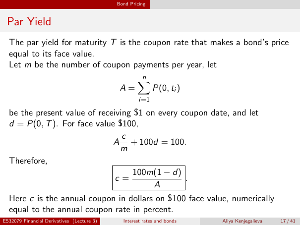

# Physical page 17 — raw extraction, needs review

<a id="page-17"></a>



Raw layout text below may flatten formulas, tables and glyphs. The image is source evidence; no semantic verification is claimed.

```text
                                            Bond Pricing


 Par Yield
  The par yield for maturity T is the coupon rate that makes a bond’s price
  equal to its face value.
  Let m be the number of coupon payments per year, let
                                                    n
                                                    X
                                             A=            P(0, ti )
                                                     i=1

  be the present value of receiving $1 on every coupon date, and let
  d = P(0, T ). For face value $100,
                                 c
                              A + 100d = 100.
                                m
  Therefore,
                                    100m(1 − d)
                               c=                .
                                         A
  Here c is the annual coupon in dollars on $100 face value, numerically
  equal to the annual coupon rate in percent.
ES32079 Financial Derivatives (Lecture 3)     Interest rates and bonds   Aliya Kenjegalieva   17 / 41

```
