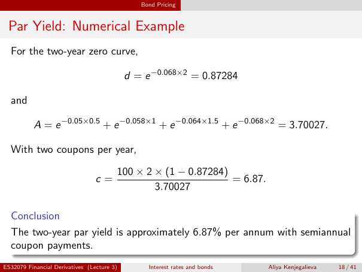

# Physical page 18 — raw extraction, needs review

<a id="page-18"></a>



Raw layout text below may flatten formulas, tables and glyphs. The image is source evidence; no semantic verification is claimed.

```text
                                               Bond Pricing


 Par Yield: Numerical Example
  For the two-year zero curve,

                                            d = e −0.068×2 = 0.87284

  and

          A = e −0.05×0.5 + e −0.058×1 + e −0.064×1.5 + e −0.068×2 = 3.70027.

  With two coupons per year,

                                        100 × 2 × (1 − 0.87284)
                                 c=                             = 6.87.
                                                3.70027

  Conclusion
  The two-year par yield is approximately 6.87% per annum with semiannual
  coupon payments.
ES32079 Financial Derivatives (Lecture 3)        Interest rates and bonds   Aliya Kenjegalieva   18 / 41

```
