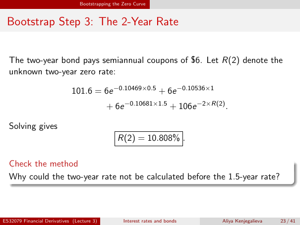

# Physical page 23 — raw extraction, needs review

<a id="page-23"></a>



Raw layout text below may flatten formulas, tables and glyphs. The image is source evidence; no semantic verification is claimed.

```text
                                 Bootstrapping the Zero Curve


 Bootstrap Step 3: The 2-Year Rate


  The two-year bond pays semiannual coupons of $6. Let R(2) denote the
  unknown two-year zero rate:

                             101.6 = 6e −0.10469×0.5 + 6e −0.10536×1
                                            + 6e −0.10681×1.5 + 106e −2×R(2) .

  Solving gives
                                                R(2) = 10.808% .

  Check the method
  Why could the two-year rate not be calculated before the 1.5-year rate?


ES32079 Financial Derivatives (Lecture 3)          Interest rates and bonds   Aliya Kenjegalieva   23 / 41

```
