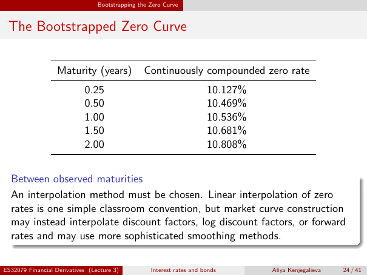

# Physical page 24 — raw extraction, needs review

<a id="page-24"></a>



Raw layout text below may flatten formulas, tables and glyphs. The image is source evidence; no semantic verification is claimed.

```text
                                 Bootstrapping the Zero Curve


 The Bootstrapped Zero Curve

                   Maturity (years)              Continuously compounded zero rate
                            0.25                                       10.127%
                            0.50                                       10.469%
                            1.00                                       10.536%
                            1.50                                       10.681%
                            2.00                                       10.808%


  Between observed maturities
  An interpolation method must be chosen. Linear interpolation of zero
  rates is one simple classroom convention, but market curve construction
  may instead interpolate discount factors, log discount factors, or forward
  rates and may use more sophisticated smoothing methods.

ES32079 Financial Derivatives (Lecture 3)          Interest rates and bonds      Aliya Kenjegalieva   24 / 41

```
