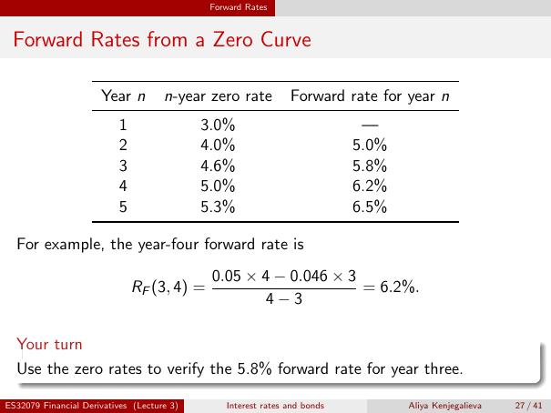

# Physical page 27 — raw extraction, needs review

<a id="page-27"></a>



Raw layout text below may flatten formulas, tables and glyphs. The image is source evidence; no semantic verification is claimed.

```text
                                             Forward Rates


 Forward Rates from a Zero Curve

                      Year n         n-year zero rate          Forward rate for year n
                          1                 3.0%                            —
                          2                 4.0%                           5.0%
                          3                 4.6%                           5.8%
                          4                 5.0%                           6.2%
                          5                 5.3%                           6.5%

  For example, the year-four forward rate is
                                             0.05 × 4 − 0.046 × 3
                              RF (3, 4) =                         = 6.2%.
                                                     4−3

  Your turn
  Use the zero rates to verify the 5.8% forward rate for year three.

ES32079 Financial Derivatives (Lecture 3)       Interest rates and bonds          Aliya Kenjegalieva   27 / 41

```
