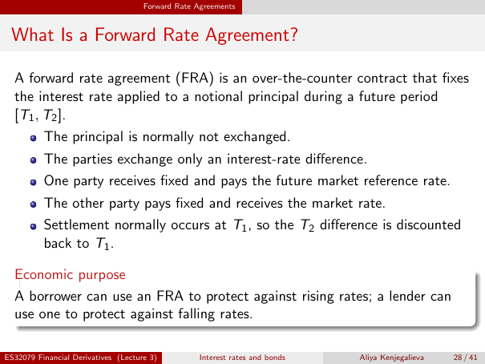

# Physical page 28 — raw extraction, needs review

<a id="page-28"></a>



Raw layout text below may flatten formulas, tables and glyphs. The image is source evidence; no semantic verification is claimed.

```text
                                     Forward Rate Agreements


 What Is a Forward Rate Agreement?

  A forward rate agreement (FRA) is an over-the-counter contract that fixes
  the interest rate applied to a notional principal during a future period
  [T1 , T2 ].
          The principal is normally not exchanged.
          The parties exchange only an interest-rate difference.
          One party receives fixed and pays the future market reference rate.
          The other party pays fixed and receives the market rate.
          Settlement normally occurs at T1 , so the T2 difference is discounted
          back to T1 .

  Economic purpose
  A borrower can use an FRA to protect against rising rates; a lender can
  use one to protect against falling rates.

ES32079 Financial Derivatives (Lecture 3)          Interest rates and bonds   Aliya Kenjegalieva   28 / 41

```
