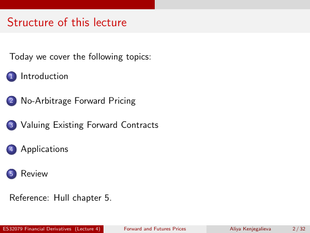

# Physical page 2 — raw extraction, needs review

<a id="page-2"></a>



Raw layout text below may flatten formulas, tables and glyphs. The image is source evidence; no semantic verification is claimed.

```text
 Structure of this lecture

  Today we cover the following topics:

  1    Introduction

  2    No-Arbitrage Forward Pricing

  3    Valuing Existing Forward Contracts

  4    Applications

  5    Review

  Reference: Hull chapter 5.


ES32079 Financial Derivatives (Lecture 4)   Forward and Futures Prices   Aliya Kenjegalieva   2 / 32

```
