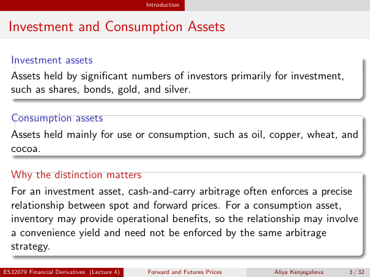

# Physical page 3 — raw extraction, needs review

<a id="page-3"></a>



Raw layout text below may flatten formulas, tables and glyphs. The image is source evidence; no semantic verification is claimed.

```text
                                            Introduction


 Investment and Consumption Assets

  Investment assets
  Assets held by significant numbers of investors primarily for investment,
  such as shares, bonds, gold, and silver.

  Consumption assets
  Assets held mainly for use or consumption, such as oil, copper, wheat, and
  cocoa.

  Why the distinction matters
  For an investment asset, cash-and-carry arbitrage often enforces a precise
  relationship between spot and forward prices. For a consumption asset,
  inventory may provide operational benefits, so the relationship may involve
  a convenience yield and need not be enforced by the same arbitrage
  strategy.

ES32079 Financial Derivatives (Lecture 4)   Forward and Futures Prices   Aliya Kenjegalieva   3 / 32

```
