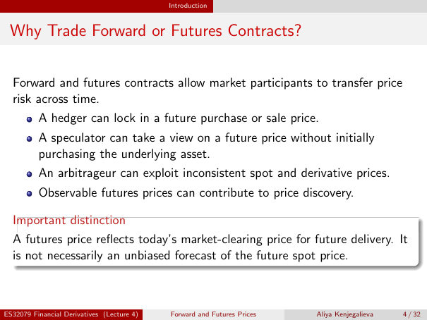

# Physical page 4 — raw extraction, needs review

<a id="page-4"></a>



Raw layout text below may flatten formulas, tables and glyphs. The image is source evidence; no semantic verification is claimed.

```text
                                            Introduction


 Why Trade Forward or Futures Contracts?


  Forward and futures contracts allow market participants to transfer price
  risk across time.
          A hedger can lock in a future purchase or sale price.
          A speculator can take a view on a future price without initially
          purchasing the underlying asset.
          An arbitrageur can exploit inconsistent spot and derivative prices.
          Observable futures prices can contribute to price discovery.

  Important distinction
  A futures price reflects today’s market-clearing price for future delivery. It
  is not necessarily an unbiased forecast of the future spot price.


ES32079 Financial Derivatives (Lecture 4)   Forward and Futures Prices   Aliya Kenjegalieva   4 / 32

```
