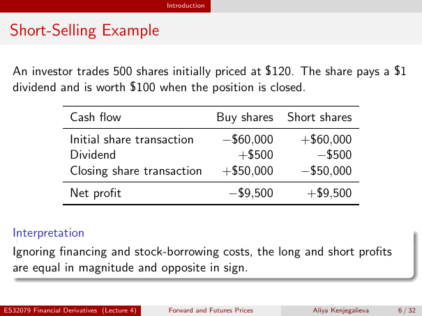

# Physical page 6 — raw extraction, needs review

<a id="page-6"></a>



Raw layout text below may flatten formulas, tables and glyphs. The image is source evidence; no semantic verification is claimed.

```text
                                            Introduction


 Short-Selling Example

  An investor trades 500 shares initially priced at $120. The share pays a $1
  dividend and is worth $100 when the position is closed.

                    Cash flow                              Buy shares    Short shares
                    Initial share transaction               −$60,000       +$60,000
                    Dividend                                  +$500          −$500
                    Closing share transaction               +$50,000       −$50,000
                    Net profit                                −$9,500       +$9,500


  Interpretation
  Ignoring financing and stock-borrowing costs, the long and short profits
  are equal in magnitude and opposite in sign.


ES32079 Financial Derivatives (Lecture 4)   Forward and Futures Prices       Aliya Kenjegalieva   6 / 32

```
