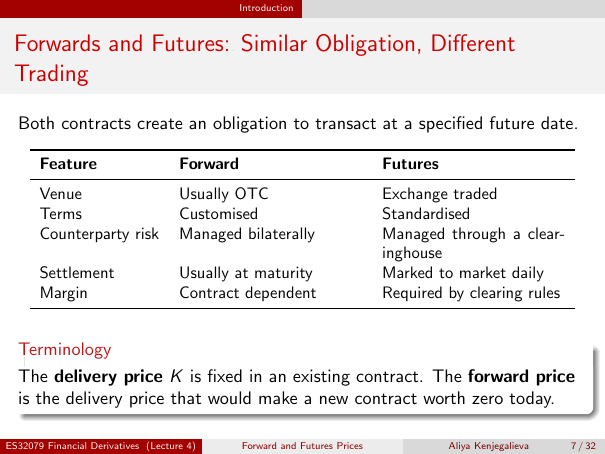

# Physical page 7 — raw extraction, needs review

<a id="page-7"></a>



Raw layout text below may flatten formulas, tables and glyphs. The image is source evidence; no semantic verification is claimed.

```text
                                               Introduction


 Forwards and Futures: Similar Obligation, Different
 Trading
  Both contracts create an obligation to transact at a specified future date.

       Feature                       Forward                                Futures
       Venue                         Usually OTC                            Exchange traded
       Terms                         Customised                             Standardised
       Counterparty risk             Managed bilaterally                    Managed through a clear-
                                                                            inghouse
       Settlement                    Usually at maturity                    Marked to market daily
       Margin                        Contract dependent                     Required by clearing rules


  Terminology
  The delivery price K is fixed in an existing contract. The forward price
  is the delivery price that would make a new contract worth zero today.

ES32079 Financial Derivatives (Lecture 4)      Forward and Futures Prices             Aliya Kenjegalieva   7 / 32

```
