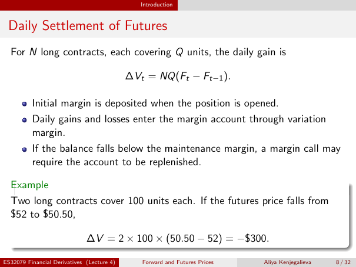

# Physical page 8 — raw extraction, needs review

<a id="page-8"></a>



Raw layout text below may flatten formulas, tables and glyphs. The image is source evidence; no semantic verification is claimed.

```text
                                               Introduction


 Daily Settlement of Futures
  For N long contracts, each covering Q units, the daily gain is

                                            ∆Vt = NQ(Ft − Ft−1 ).

          Initial margin is deposited when the position is opened.
          Daily gains and losses enter the margin account through variation
          margin.
          If the balance falls below the maintenance margin, a margin call may
          require the account to be replenished.

  Example
  Two long contracts cover 100 units each. If the futures price falls from
  $52 to $50.50,

                              ∆V = 2 × 100 × (50.50 − 52) = −$300.

ES32079 Financial Derivatives (Lecture 4)      Forward and Futures Prices   Aliya Kenjegalieva   8 / 32

```
