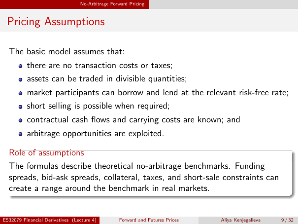

# Physical page 9 — raw extraction, needs review

<a id="page-9"></a>



Raw layout text below may flatten formulas, tables and glyphs. The image is source evidence; no semantic verification is claimed.

```text
                                 No-Arbitrage Forward Pricing


 Pricing Assumptions

  The basic model assumes that:
          there are no transaction costs or taxes;
          assets can be traded in divisible quantities;
          market participants can borrow and lend at the relevant risk-free rate;
          short selling is possible when required;
          contractual cash flows and carrying costs are known; and
          arbitrage opportunities are exploited.

  Role of assumptions
  The formulas describe theoretical no-arbitrage benchmarks. Funding
  spreads, bid-ask spreads, collateral, taxes, and short-sale constraints can
  create a range around the benchmark in real markets.


ES32079 Financial Derivatives (Lecture 4)        Forward and Futures Prices   Aliya Kenjegalieva   9 / 32

```
