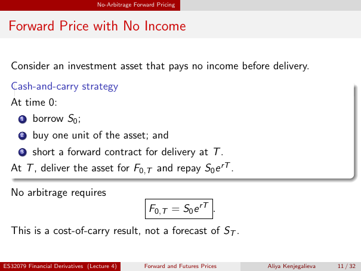

# Physical page 11 — raw extraction, needs review

<a id="page-11"></a>



Raw layout text below may flatten formulas, tables and glyphs. The image is source evidence; no semantic verification is claimed.

```text
                                 No-Arbitrage Forward Pricing


 Forward Price with No Income

  Consider an investment asset that pays no income before delivery.
  Cash-and-carry strategy
  At time 0:
      1   borrow S0 ;
      2   buy one unit of the asset; and
      3   short a forward contract for delivery at T .
  At T , deliver the asset for F0,T and repay S0 e rT .

  No arbitrage requires
                                                   F0,T = S0 e rT .
  This is a cost-of-carry result, not a forecast of ST .


ES32079 Financial Derivatives (Lecture 4)        Forward and Futures Prices   Aliya Kenjegalieva   11 / 32

```
