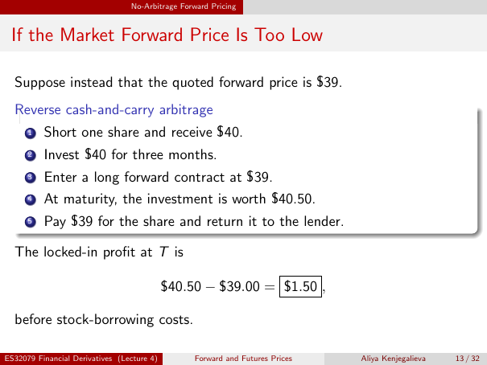

# Physical page 13 — raw extraction, needs review

<a id="page-13"></a>



Raw layout text below may flatten formulas, tables and glyphs. The image is source evidence; no semantic verification is claimed.

```text
                                 No-Arbitrage Forward Pricing


 If the Market Forward Price Is Too Low

  Suppose instead that the quoted forward price is $39.
  Reverse cash-and-carry arbitrage
      1   Short one share and receive $40.
      2   Invest $40 for three months.
      3   Enter a long forward contract at $39.
      4   At maturity, the investment is worth $40.50.
      5   Pay $39 for the share and return it to the lender.

  The locked-in profit at T is

                                            $40.50 − $39.00 = $1.50 ,

  before stock-borrowing costs.

ES32079 Financial Derivatives (Lecture 4)        Forward and Futures Prices   Aliya Kenjegalieva   13 / 32

```
