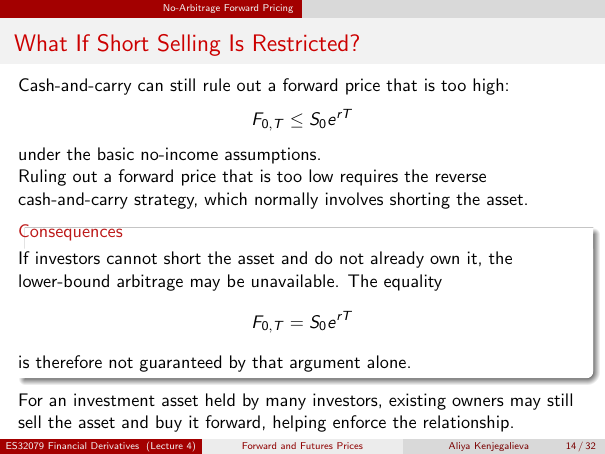

# Physical page 14 — raw extraction, needs review

<a id="page-14"></a>



Raw layout text below may flatten formulas, tables and glyphs. The image is source evidence; no semantic verification is claimed.

```text
                                 No-Arbitrage Forward Pricing


 What If Short Selling Is Restricted?
  Cash-and-carry can still rule out a forward price that is too high:
                                                   F0,T ≤ S0 e rT
  under the basic no-income assumptions.
  Ruling out a forward price that is too low requires the reverse
  cash-and-carry strategy, which normally involves shorting the asset.
  Consequences
  If investors cannot short the asset and do not already own it, the
  lower-bound arbitrage may be unavailable. The equality

                                                   F0,T = S0 e rT

  is therefore not guaranteed by that argument alone.

  For an investment asset held by many investors, existing owners may still
  sell the asset and buy it forward, helping enforce the relationship.
ES32079 Financial Derivatives (Lecture 4)        Forward and Futures Prices   Aliya Kenjegalieva   14 / 32

```
