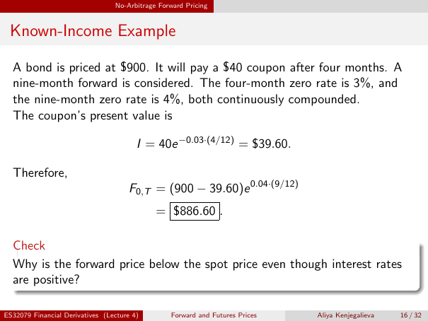

# Physical page 16 — raw extraction, needs review

<a id="page-16"></a>



Raw layout text below may flatten formulas, tables and glyphs. The image is source evidence; no semantic verification is claimed.

```text
                                 No-Arbitrage Forward Pricing


 Known-Income Example

  A bond is priced at $900. It will pay a $40 coupon after four months. A
  nine-month forward is considered. The four-month zero rate is 3%, and
  the nine-month zero rate is 4%, both continuously compounded.
  The coupon’s present value is

                                        I = 40e −0.03·(4/12) = $39.60.

  Therefore,
                                     F0,T = (900 − 39.60)e 0.04·(9/12)
                                             = $886.60 .

  Check
  Why is the forward price below the spot price even though interest rates
  are positive?

ES32079 Financial Derivatives (Lecture 4)        Forward and Futures Prices   Aliya Kenjegalieva   16 / 32

```
