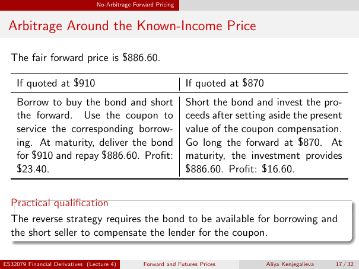

# Physical page 17 — raw extraction, needs review

<a id="page-17"></a>



Raw layout text below may flatten formulas, tables and glyphs. The image is source evidence; no semantic verification is claimed.

```text
                                 No-Arbitrage Forward Pricing


 Arbitrage Around the Known-Income Price

  The fair forward price is $886.60.

    If quoted at $910                                           If quoted at $870
    Borrow to buy the bond and short                            Short the bond and invest the pro-
    the forward. Use the coupon to                              ceeds after setting aside the present
    service the corresponding borrow-                           value of the coupon compensation.
    ing. At maturity, deliver the bond                          Go long the forward at $870. At
    for $910 and repay $886.60. Profit:                         maturity, the investment provides
    $23.40.                                                     $886.60. Profit: $16.60.


  Practical qualification
  The reverse strategy requires the bond to be available for borrowing and
  the short seller to compensate the lender for the coupon.

ES32079 Financial Derivatives (Lecture 4)        Forward and Futures Prices         Aliya Kenjegalieva   17 / 32

```
