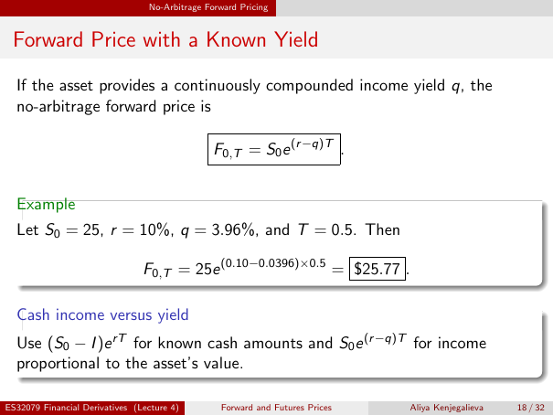

# Physical page 18 — raw extraction, needs review

<a id="page-18"></a>



Raw layout text below may flatten formulas, tables and glyphs. The image is source evidence; no semantic verification is claimed.

```text
                                 No-Arbitrage Forward Pricing


 Forward Price with a Known Yield

  If the asset provides a continuously compounded income yield q, the
  no-arbitrage forward price is

                                                F0,T = S0 e (r −q)T .


  Example
  Let S0 = 25, r = 10%, q = 3.96%, and T = 0.5. Then

                                F0,T = 25e (0.10−0.0396)×0.5 = $25.77 .

  Cash income versus yield
  Use (S0 − I )e rT for known cash amounts and S0 e (r −q)T for income
  proportional to the asset’s value.

ES32079 Financial Derivatives (Lecture 4)        Forward and Futures Prices   Aliya Kenjegalieva   18 / 32

```
