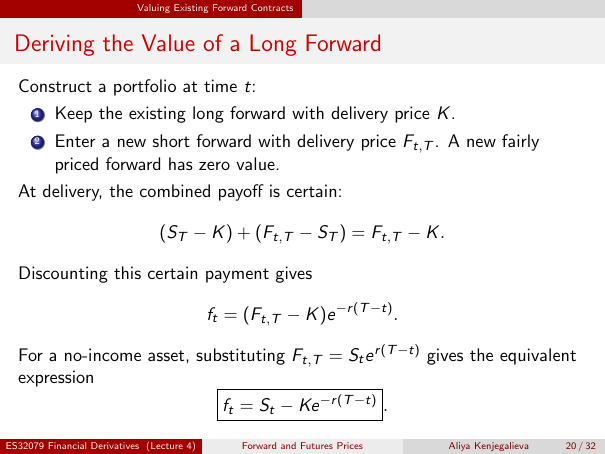

# Physical page 20 — raw extraction, needs review

<a id="page-20"></a>



Raw layout text below may flatten formulas, tables and glyphs. The image is source evidence; no semantic verification is claimed.

```text
                            Valuing Existing Forward Contracts


 Deriving the Value of a Long Forward
  Construct a portfolio at time t:
      1   Keep the existing long forward with delivery price K .
      2   Enter a new short forward with delivery price Ft,T . A new fairly
          priced forward has zero value.
  At delivery, the combined payoff is certain:

                                 (ST − K ) + (Ft,T − ST ) = Ft,T − K .

  Discounting this certain payment gives

                                            ft = (Ft,T − K )e −r (T −t) .

  For a no-income asset, substituting Ft,T = St e r (T −t) gives the equivalent
  expression
                                              ft = St − Ke −r (T −t) .

ES32079 Financial Derivatives (Lecture 4)         Forward and Futures Prices   Aliya Kenjegalieva   20 / 32

```
