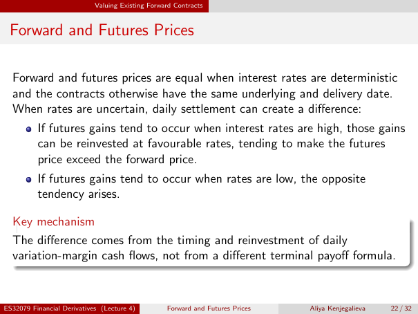

# Physical page 22 — raw extraction, needs review

<a id="page-22"></a>



Raw layout text below may flatten formulas, tables and glyphs. The image is source evidence; no semantic verification is claimed.

```text
                            Valuing Existing Forward Contracts


 Forward and Futures Prices

  Forward and futures prices are equal when interest rates are deterministic
  and the contracts otherwise have the same underlying and delivery date.
  When rates are uncertain, daily settlement can create a difference:
          If futures gains tend to occur when interest rates are high, those gains
          can be reinvested at favourable rates, tending to make the futures
          price exceed the forward price.
          If futures gains tend to occur when rates are low, the opposite
          tendency arises.

  Key mechanism
  The difference comes from the timing and reinvestment of daily
  variation-margin cash flows, not from a different terminal payoff formula.


ES32079 Financial Derivatives (Lecture 4)         Forward and Futures Prices   Aliya Kenjegalieva   22 / 32

```
