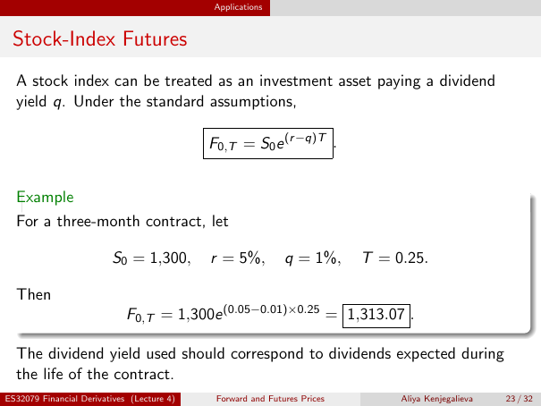

# Physical page 23 — raw extraction, needs review

<a id="page-23"></a>



Raw layout text below may flatten formulas, tables and glyphs. The image is source evidence; no semantic verification is claimed.

```text
                                            Applications


 Stock-Index Futures
  A stock index can be treated as an investment asset paying a dividend
  yield q. Under the standard assumptions,

                                            F0,T = S0 e (r −q)T .


  Example
  For a three-month contract, let

                         S0 = 1,300,        r = 5%,          q = 1%,      T = 0.25.

  Then
                             F0,T = 1,300e (0.05−0.01)×0.25 = 1,313.07 .

  The dividend yield used should correspond to dividends expected during
  the life of the contract.
ES32079 Financial Derivatives (Lecture 4)    Forward and Futures Prices        Aliya Kenjegalieva   23 / 32

```
