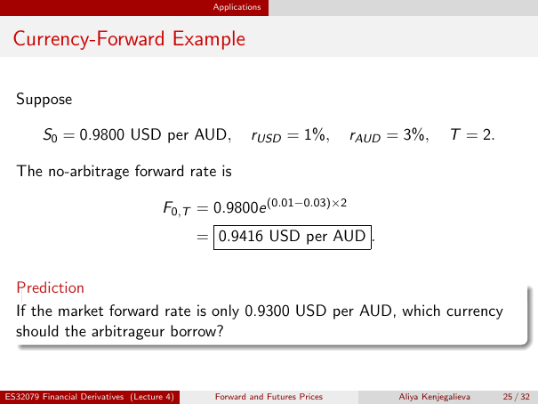

# Physical page 25 — raw extraction, needs review

<a id="page-25"></a>



Raw layout text below may flatten formulas, tables and glyphs. The image is source evidence; no semantic verification is claimed.

```text
                                              Applications


 Currency-Forward Example

  Suppose

         S0 = 0.9800 USD per AUD,                      rUSD = 1%,          rAUD = 3%,        T = 2.

  The no-arbitrage forward rate is

                                      F0,T = 0.9800e (0.01−0.03)×2
                                            = 0.9416 USD per AUD .


  Prediction
  If the market forward rate is only 0.9300 USD per AUD, which currency
  should the arbitrageur borrow?


ES32079 Financial Derivatives (Lecture 4)     Forward and Futures Prices         Aliya Kenjegalieva   25 / 32

```
