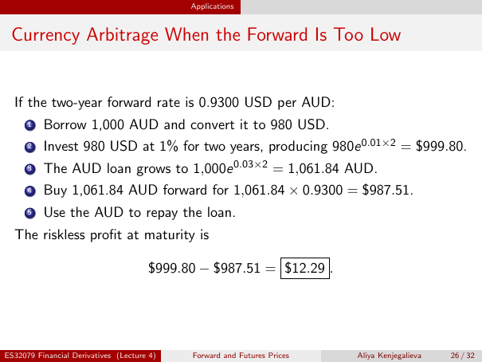

# Physical page 26 — raw extraction, needs review

<a id="page-26"></a>



Raw layout text below may flatten formulas, tables and glyphs. The image is source evidence; no semantic verification is claimed.

```text
                                            Applications


 Currency Arbitrage When the Forward Is Too Low


  If the two-year forward rate is 0.9300 USD per AUD:
      1   Borrow 1,000 AUD and convert it to 980 USD.
      2   Invest 980 USD at 1% for two years, producing 980e 0.01×2 = $999.80.
      3   The AUD loan grows to 1,000e 0.03×2 = 1,061.84 AUD.
      4   Buy 1,061.84 AUD forward for 1,061.84 × 0.9300 = $987.51.
      5   Use the AUD to repay the loan.
  The riskless profit at maturity is

                                      $999.80 − $987.51 = $12.29 .


ES32079 Financial Derivatives (Lecture 4)   Forward and Futures Prices   Aliya Kenjegalieva   26 / 32

```
