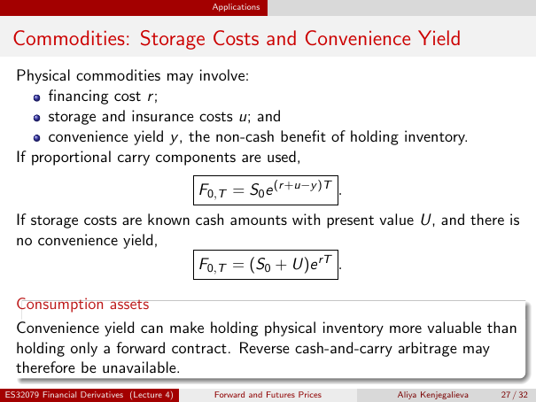

# Physical page 27 — raw extraction, needs review

<a id="page-27"></a>



Raw layout text below may flatten formulas, tables and glyphs. The image is source evidence; no semantic verification is claimed.

```text
                                              Applications


 Commodities: Storage Costs and Convenience Yield
  Physical commodities may involve:
        financing cost r ;
        storage and insurance costs u; and
        convenience yield y , the non-cash benefit of holding inventory.
  If proportional carry components are used,

                                            F0,T = S0 e (r +u−y )T .
  If storage costs are known cash amounts with present value U, and there is
  no convenience yield,
                                            F0,T = (S0 + U)e rT .

  Consumption assets
  Convenience yield can make holding physical inventory more valuable than
  holding only a forward contract. Reverse cash-and-carry arbitrage may
  therefore be unavailable.
ES32079 Financial Derivatives (Lecture 4)     Forward and Futures Prices   Aliya Kenjegalieva   27 / 32

```
