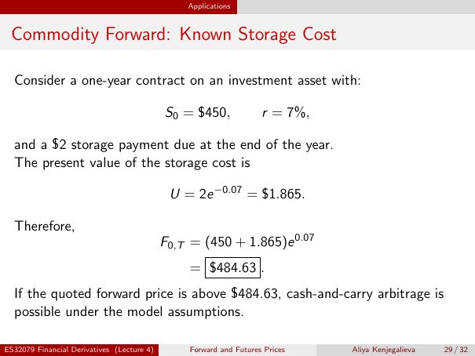

# Physical page 29 — raw extraction, needs review

<a id="page-29"></a>



Raw layout text below may flatten formulas, tables and glyphs. The image is source evidence; no semantic verification is claimed.

```text
                                                Applications


 Commodity Forward: Known Storage Cost

  Consider a one-year contract on an investment asset with:

                                            S0 = $450,              r = 7%,

  and a $2 storage payment due at the end of the year.
  The present value of the storage cost is

                                             U = 2e −0.07 = $1.865.

  Therefore,
                                            F0,T = (450 + 1.865)e 0.07
                                                 = $484.63 .
  If the quoted forward price is above $484.63, cash-and-carry arbitrage is
  possible under the model assumptions.

ES32079 Financial Derivatives (Lecture 4)        Forward and Futures Prices   Aliya Kenjegalieva   29 / 32

```
