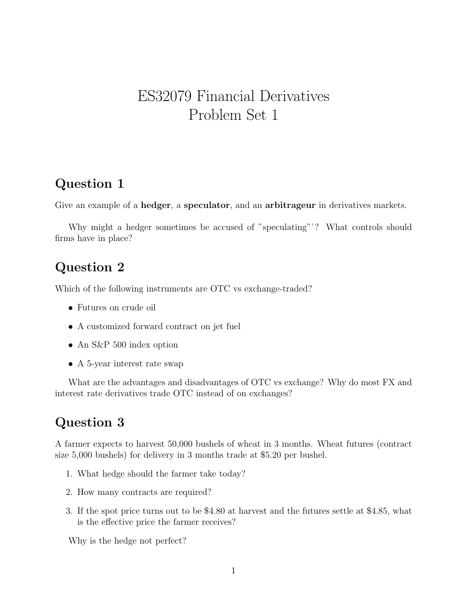

# Physical page 1 — raw extraction, needs review

<a id="page-1"></a>



Raw layout text below may flatten formulas, tables and glyphs. The image is source evidence; no semantic verification is claimed.

```text
                    ES32079 Financial Derivatives
                           Problem Set 1


Question 1
Give an example of a hedger, a speculator, and an arbitrageur in derivatives markets.

    Why might a hedger sometimes be accused of ”speculating”’ ? What controls should
firms have in place?


Question 2
Which of the following instruments are OTC vs exchange-traded?

   ˆ Futures on crude oil

   ˆ A customized forward contract on jet fuel

   ˆ An S&P 500 index option

   ˆ A 5-year interest rate swap

    What are the advantages and disadvantages of OTC vs exchange? Why do most FX and
interest rate derivatives trade OTC instead of on exchanges?


Question 3
A farmer expects to harvest 50,000 bushels of wheat in 3 months. Wheat futures (contract
size 5,000 bushels) for delivery in 3 months trade at $5.20 per bushel.

  1. What hedge should the farmer take today?

  2. How many contracts are required?

  3. If the spot price turns out to be $4.80 at harvest and the futures settle at $4.85, what
     is the effective price the farmer receives?

   Why is the hedge not perfect?


                                             1

```
