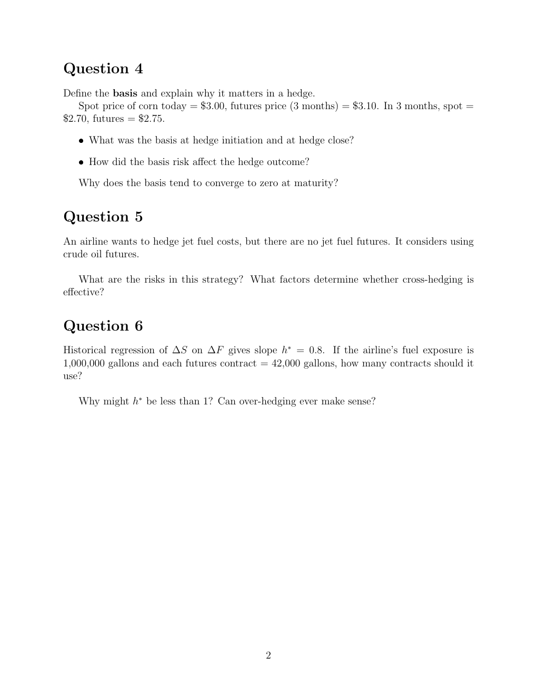

# Physical page 2 — raw extraction, needs review

<a id="page-2"></a>



Raw layout text below may flatten formulas, tables and glyphs. The image is source evidence; no semantic verification is claimed.

```text
Question 4
Define the basis and explain why it matters in a hedge.
   Spot price of corn today = $3.00, futures price (3 months) = $3.10. In 3 months, spot =
$2.70, futures = $2.75.

   ˆ What was the basis at hedge initiation and at hedge close?

   ˆ How did the basis risk affect the hedge outcome?

   Why does the basis tend to converge to zero at maturity?


Question 5
An airline wants to hedge jet fuel costs, but there are no jet fuel futures. It considers using
crude oil futures.

    What are the risks in this strategy? What factors determine whether cross-hedging is
effective?


Question 6
Historical regression of ∆S on ∆F gives slope h∗ = 0.8. If the airline’s fuel exposure is
1,000,000 gallons and each futures contract = 42,000 gallons, how many contracts should it
use?

   Why might h∗ be less than 1? Can over-hedging ever make sense?


                                              2

```
