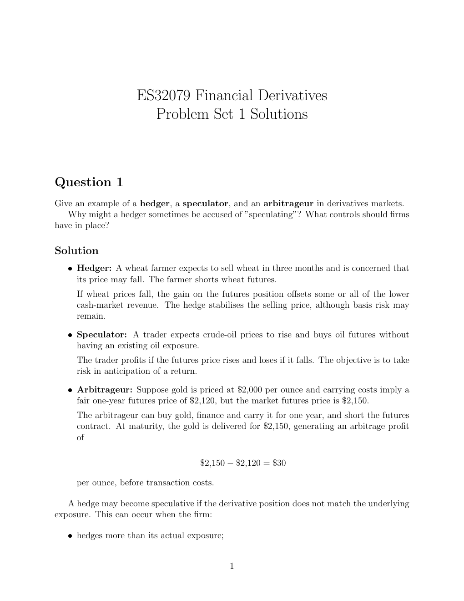

# Physical page 1 — raw extraction, needs review

<a id="page-1"></a>



Raw layout text below may flatten formulas, tables and glyphs. The image is source evidence; no semantic verification is claimed.

```text
                     ES32079 Financial Derivatives
                       Problem Set 1 Solutions


Question 1
Give an example of a hedger, a speculator, and an arbitrageur in derivatives markets.
   Why might a hedger sometimes be accused of ”speculating”? What controls should firms
have in place?

Solution
   ˆ Hedger: A wheat farmer expects to sell wheat in three months and is concerned that
     its price may fall. The farmer shorts wheat futures.
     If wheat prices fall, the gain on the futures position offsets some or all of the lower
     cash-market revenue. The hedge stabilises the selling price, although basis risk may
     remain.

   ˆ Speculator: A trader expects crude-oil prices to rise and buys oil futures without
     having an existing oil exposure.
     The trader profits if the futures price rises and loses if it falls. The objective is to take
     risk in anticipation of a return.

   ˆ Arbitrageur: Suppose gold is priced at $2,000 per ounce and carrying costs imply a
     fair one-year futures price of $2,120, but the market futures price is $2,150.
     The arbitrageur can buy gold, finance and carry it for one year, and short the futures
     contract. At maturity, the gold is delivered for $2,150, generating an arbitrage profit
     of

                                       $2,150 − $2,120 = $30

     per ounce, before transaction costs.

   A hedge may become speculative if the derivative position does not match the underlying
exposure. This can occur when the firm:

   ˆ hedges more than its actual exposure;


                                               1

```
