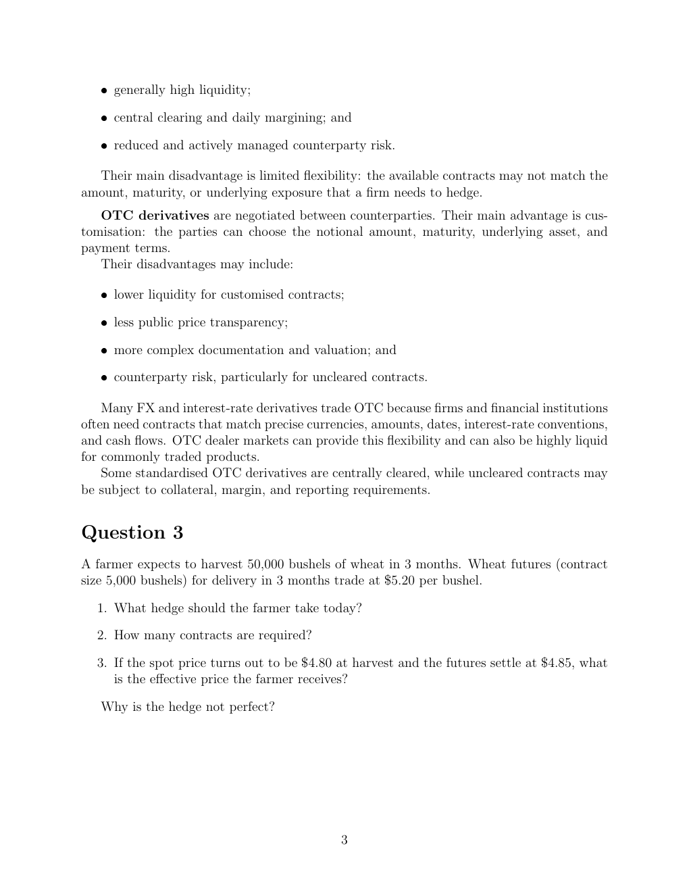

# Physical page 3 — raw extraction, needs review

<a id="page-3"></a>



Raw layout text below may flatten formulas, tables and glyphs. The image is source evidence; no semantic verification is claimed.

```text
   ˆ generally high liquidity;

   ˆ central clearing and daily margining; and

   ˆ reduced and actively managed counterparty risk.

  Their main disadvantage is limited flexibility: the available contracts may not match the
amount, maturity, or underlying exposure that a firm needs to hedge.
   OTC derivatives are negotiated between counterparties. Their main advantage is cus-
tomisation: the parties can choose the notional amount, maturity, underlying asset, and
payment terms.
   Their disadvantages may include:

   ˆ lower liquidity for customised contracts;

   ˆ less public price transparency;

   ˆ more complex documentation and valuation; and

   ˆ counterparty risk, particularly for uncleared contracts.

    Many FX and interest-rate derivatives trade OTC because firms and financial institutions
often need contracts that match precise currencies, amounts, dates, interest-rate conventions,
and cash flows. OTC dealer markets can provide this flexibility and can also be highly liquid
for commonly traded products.
    Some standardised OTC derivatives are centrally cleared, while uncleared contracts may
be subject to collateral, margin, and reporting requirements.


Question 3
A farmer expects to harvest 50,000 bushels of wheat in 3 months. Wheat futures (contract
size 5,000 bushels) for delivery in 3 months trade at $5.20 per bushel.

  1. What hedge should the farmer take today?

  2. How many contracts are required?

  3. If the spot price turns out to be $4.80 at harvest and the futures settle at $4.85, what
     is the effective price the farmer receives?

   Why is the hedge not perfect?


                                              3

```
