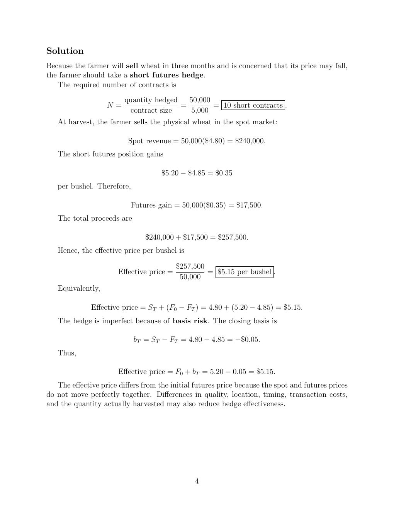

# Physical page 4 — raw extraction, needs review

<a id="page-4"></a>



Raw layout text below may flatten formulas, tables and glyphs. The image is source evidence; no semantic verification is claimed.

```text
Solution
Because the farmer will sell wheat in three months and is concerned that its price may fall,
the farmer should take a short futures hedge.
   The required number of contracts is
                         quantity hedged   50,000
                   N=                    =        = 10 short contracts .
                          contract size    5,000
   At harvest, the farmer sells the physical wheat in the spot market:

                          Spot revenue = 50,000($4.80) = $240,000.
   The short futures position gains

                                     $5.20 − $4.85 = $0.35
   per bushel. Therefore,

                           Futures gain = 50,000($0.35) = $17,500.
   The total proceeds are

                               $240,000 + $17,500 = $257,500.
   Hence, the effective price per bushel is

                                           $257,500
                       Effective price =            = $5.15 per bushel .
                                            50,000
   Equivalently,

              Effective price = ST + (F0 − FT ) = 4.80 + (5.20 − 4.85) = $5.15.
   The hedge is imperfect because of basis risk. The closing basis is

                            bT = ST − FT = 4.80 − 4.85 = −$0.05.
   Thus,

                       Effective price = F0 + bT = 5.20 − 0.05 = $5.15.
   The effective price differs from the initial futures price because the spot and futures prices
do not move perfectly together. Differences in quality, location, timing, transaction costs,
and the quantity actually harvested may also reduce hedge effectiveness.


                                                4

```
