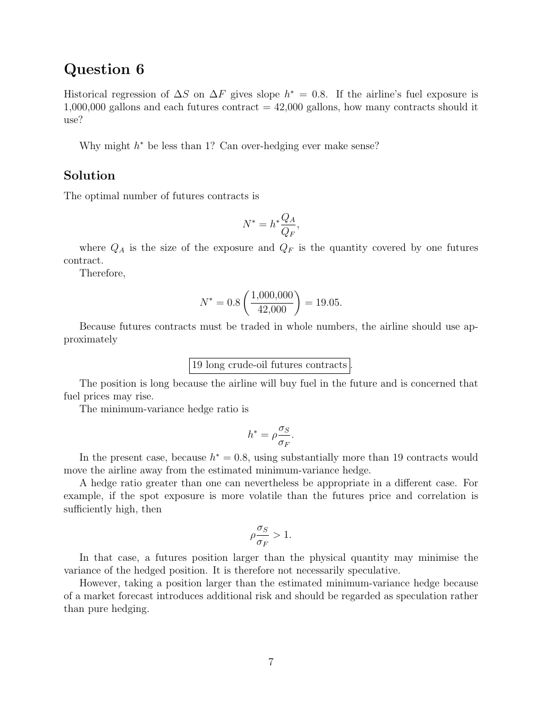

# Physical page 7 — raw extraction, needs review

<a id="page-7"></a>



Raw layout text below may flatten formulas, tables and glyphs. The image is source evidence; no semantic verification is claimed.

```text
Question 6
Historical regression of ∆S on ∆F gives slope h∗ = 0.8. If the airline’s fuel exposure is
1,000,000 gallons and each futures contract = 42,000 gallons, how many contracts should it
use?

   Why might h∗ be less than 1? Can over-hedging ever make sense?

Solution
The optimal number of futures contracts is
                                                   QA
                                        N ∗ = h∗      ,
                                                   QF
   where QA is the size of the exposure and QF is the quantity covered by one futures
contract.
   Therefore,
                                                
                              ∗        1,000,000
                            N = 0.8                = 19.05.
                                        42,000
   Because futures contracts must be traded in whole numbers, the airline should use ap-
proximately

                             19 long crude-oil futures contracts .
    The position is long because the airline will buy fuel in the future and is concerned that
fuel prices may rise.
    The minimum-variance hedge ratio is
                                                σS
                                         h∗ = ρ    .
                                                σF
    In the present case, because h∗ = 0.8, using substantially more than 19 contracts would
move the airline away from the estimated minimum-variance hedge.
    A hedge ratio greater than one can nevertheless be appropriate in a different case. For
example, if the spot exposure is more volatile than the futures price and correlation is
sufficiently high, then
                                            σS
                                          ρ     > 1.
                                            σF
    In that case, a futures position larger than the physical quantity may minimise the
variance of the hedged position. It is therefore not necessarily speculative.
    However, taking a position larger than the estimated minimum-variance hedge because
of a market forecast introduces additional risk and should be regarded as speculation rather
than pure hedging.


                                              7

```
