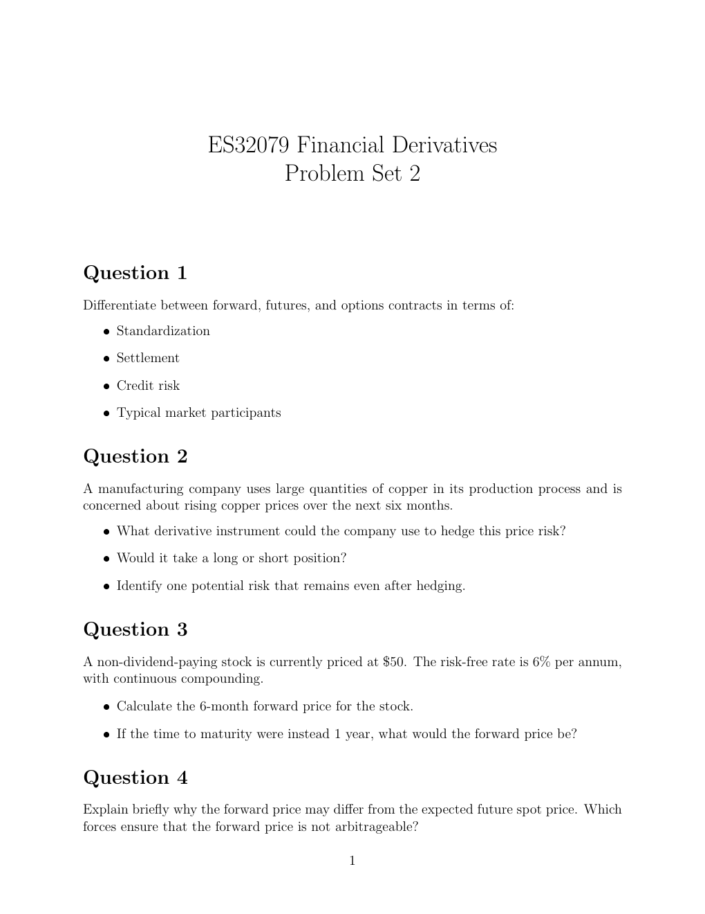

# Physical page 1 — raw extraction, needs review

<a id="page-1"></a>



Raw layout text below may flatten formulas, tables and glyphs. The image is source evidence; no semantic verification is claimed.

```text
                     ES32079 Financial Derivatives
                            Problem Set 2


Question 1
Differentiate between forward, futures, and options contracts in terms of:
   ˆ Standardization

   ˆ Settlement

   ˆ Credit risk

   ˆ Typical market participants


Question 2
A manufacturing company uses large quantities of copper in its production process and is
concerned about rising copper prices over the next six months.
   ˆ What derivative instrument could the company use to hedge this price risk?

   ˆ Would it take a long or short position?

   ˆ Identify one potential risk that remains even after hedging.


Question 3
A non-dividend-paying stock is currently priced at $50. The risk-free rate is 6% per annum,
with continuous compounding.

   ˆ Calculate the 6-month forward price for the stock.

   ˆ If the time to maturity were instead 1 year, what would the forward price be?


Question 4
Explain briefly why the forward price may differ from the expected future spot price. Which
forces ensure that the forward price is not arbitrageable?

                                               1

```
