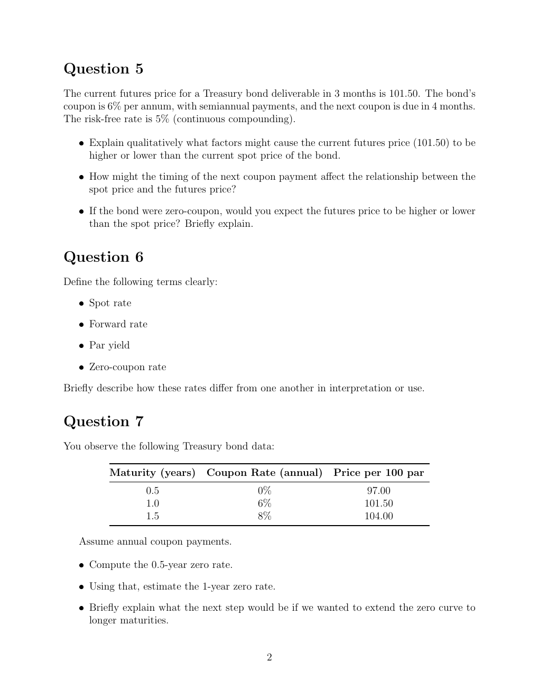

# Physical page 2 — raw extraction, needs review

<a id="page-2"></a>



Raw layout text below may flatten formulas, tables and glyphs. The image is source evidence; no semantic verification is claimed.

```text
Question 5
The current futures price for a Treasury bond deliverable in 3 months is 101.50. The bond’s
coupon is 6% per annum, with semiannual payments, and the next coupon is due in 4 months.
The risk-free rate is 5% (continuous compounding).

   ˆ Explain qualitatively what factors might cause the current futures price (101.50) to be
     higher or lower than the current spot price of the bond.

   ˆ How might the timing of the next coupon payment affect the relationship between the
     spot price and the futures price?

   ˆ If the bond were zero-coupon, would you expect the futures price to be higher or lower
     than the spot price? Briefly explain.


Question 6
Define the following terms clearly:
   ˆ Spot rate

   ˆ Forward rate

   ˆ Par yield

   ˆ Zero-coupon rate

Briefly describe how these rates differ from one another in interpretation or use.


Question 7
You observe the following Treasury bond data:

          Maturity (years)      Coupon Rate (annual)         Price per 100 par
                  0.5                       0%                       97.00
                  1.0                       6%                      101.50
                  1.5                       8%                      104.00

   Assume annual coupon payments.

   ˆ Compute the 0.5-year zero rate.

   ˆ Using that, estimate the 1-year zero rate.

   ˆ Briefly explain what the next step would be if we wanted to extend the zero curve to
     longer maturities.


                                              2

```
