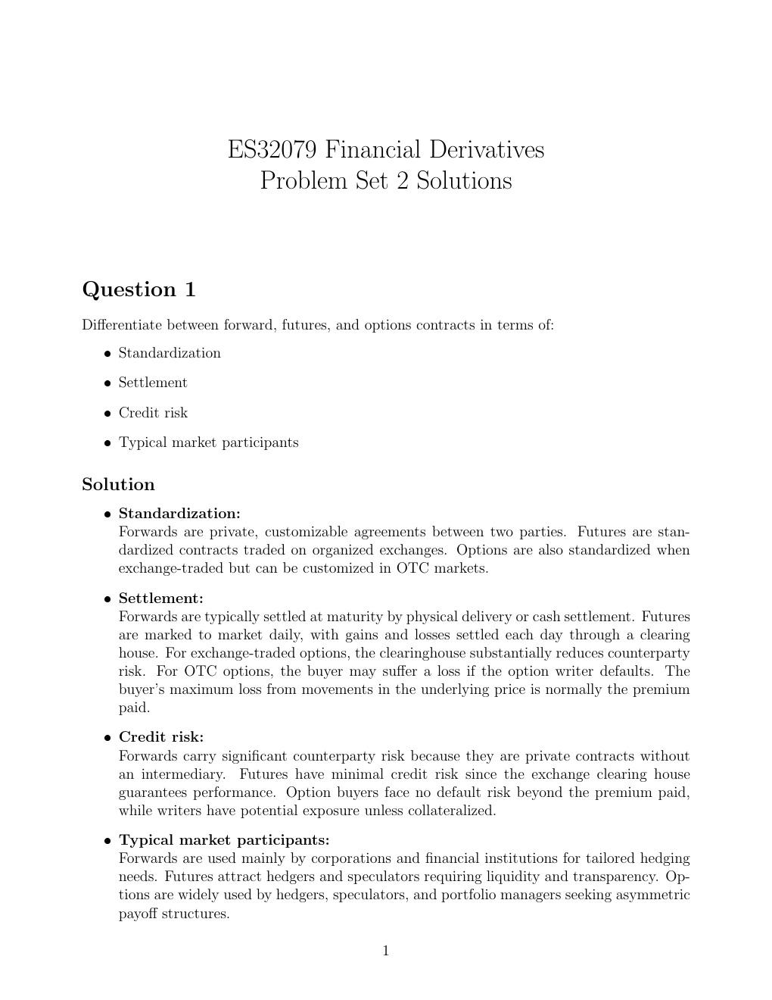

# Physical page 1 — raw extraction, needs review

<a id="page-1"></a>



Raw layout text below may flatten formulas, tables and glyphs. The image is source evidence; no semantic verification is claimed.

```text
                       ES32079 Financial Derivatives
                         Problem Set 2 Solutions


Question 1
Differentiate between forward, futures, and options contracts in terms of:
   ˆ Standardization

   ˆ Settlement

   ˆ Credit risk

   ˆ Typical market participants

Solution
   ˆ Standardization:
     Forwards are private, customizable agreements between two parties. Futures are stan-
     dardized contracts traded on organized exchanges. Options are also standardized when
     exchange-traded but can be customized in OTC markets.
   ˆ Settlement:
     Forwards are typically settled at maturity by physical delivery or cash settlement. Futures
     are marked to market daily, with gains and losses settled each day through a clearing
     house. For exchange-traded options, the clearinghouse substantially reduces counterparty
     risk. For OTC options, the buyer may suffer a loss if the option writer defaults. The
     buyer’s maximum loss from movements in the underlying price is normally the premium
     paid.
   ˆ Credit risk:
     Forwards carry significant counterparty risk because they are private contracts without
     an intermediary. Futures have minimal credit risk since the exchange clearing house
     guarantees performance. Option buyers face no default risk beyond the premium paid,
     while writers have potential exposure unless collateralized.
   ˆ Typical market participants:
     Forwards are used mainly by corporations and financial institutions for tailored hedging
     needs. Futures attract hedgers and speculators requiring liquidity and transparency. Op-
     tions are widely used by hedgers, speculators, and portfolio managers seeking asymmetric
     payoff structures.

                                               1

```
